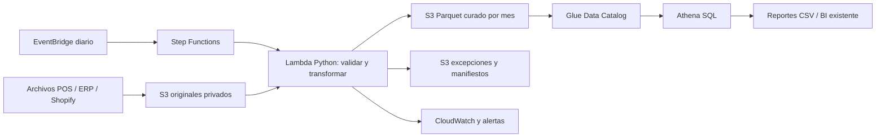

# CaféNorte: una base común para decidir

**Para Dirección General y TI · 12 de noviembre de 2026**

Propongo unificar ventas e inventario en una carga diaria trazable. Entrego una demo local que conserva los movimientos originales, identifica productos sin equivalencia y produce cuatro consultas de negocio. Mi objetivo productivo es que Dirección consulte la misma definición de ventas y que TI pueda explicar cada cifra hasta su archivo de origen.

## Arquitectura AWS propuesta

Elijo almacenamiento S3 y cómputo bajo demanda por el volumen y el presupuesto. Mantengo originales inmutables con versionado, manifiestos SHA-256 y permisos separados; el modelo curado excluye datos personales. Glue registra esquemas sin crawlers permanentes; Athena consulta Parquet particionado para limitar lectura. Lambda ejecuta lotes pequeños; si el perfil supera 15 minutos o memoria disponible, evaluaré Fargate antes de comprometer el servicio. La demo usa pandas y SQLite; producción requiere adaptar entradas S3, publicación Parquet y orquestación, sin cambiar las reglas analíticas.

Uso IAM de mínimo privilegio, bloqueo de acceso público, cifrado S3, secretos fuera del código y logs sin datos personales. Step Functions valida la llegada de las cuatro fuentes, reintenta fallos transitorios y alerta ante incumplimientos. Publico cada ejecución en un prefijo nuevo; el manifiesto aprobado apunta a la versión vigente. La clave archivo–hash evita reprocesos accidentales y permite reconstruir una carga. Mantengo la última publicación válida si falla una validación.

## Presupuesto mensual

Estimo **USD 75 al mes**, con límite objetivo de USD 200, para us-east-1, 30 cargas, 50 GB retenidos y 1 TB total consultado al mes. Son supuestos de dimensionamiento, pendientes de medir con TI; no dependo de free tier. Importes sin impuestos, personal, soporte contratado ni licencias BI; entrego CSV y consultas para el BI existente.

Leyenda: provisión mensual en USD; las reservas cubren servicios auxiliares y variación de consumo, no son cotizaciones unitarias.

| Concepto | Cálculo o provisión | USD |
|---|---|---:|
| S3 almacenamiento | 50 GB × supuesto 0.023 USD/GB-mes | 1.15 |
| Solicitudes S3 | Reserva por lectura, escritura y versionado | 3.85 |
| Lambda | 30 × 600 s × 4 GB × 0.0000166667 USD/GB-s, más solicitudes | 1.21 |
| Athena | 1 TB × 5 USD/TB | 5.00 |
| Orquestación y catálogo | Reserva EventBridge, Step Functions y Glue Catalog | 5.00 |
| Operación y seguridad | Reserva CloudWatch, secretos y alertas | 10.00 |
| Transferencias y respaldo | Reserva según retención y exportaciones | 8.79 |
| Contingencia | Crecimiento, reintentos y servicios auxiliares | 40.00 |
| **Total previsto** | **Suma del escenario** | **75.00** |

Consulté [Lambda](https://aws.amazon.com/lambda/pricing/), [Athena](https://aws.amazon.com/athena/pricing/) y [S3](https://aws.amazon.com/s3/pricing/) el 12 de noviembre de 2026. El valor S3 es un supuesto presupuestario que validaré para la región contratada. Configuraré avisos de presupuesto a USD 100, 150 y 180, límite de bytes por consulta en Athena y retención de logs de 30 días. Las alertas presupuestarias no son un bloqueo automático del gasto. No incluyo NAT Gateway, servidores permanentes ni BI nuevo en este escenario.

## Implementación y acuerdos

**Fase 1, semana 1:** acordar contratos de archivo, responsables y hora de corte; automatizar carga diaria, cuatro métricas y excepciones. Aceptación: conservación de registros e importes, costo no futuro, métricas contrastadas y demo de recuperación sin duplicados.

**Fase 2, semana 2:** desplegar con infraestructura versionada, permisos, alertas, reintentos y recuperación de la última publicación; probar accesos con TI y conciliar totales mensuales contra un cierre autorizado. Mido duración y consumo antes de confirmar capacidad.

**Fase 3, posterior:** conectar APIs cuando existan accesos, integrar BI y gobernar catálogo. Priorizo resolver equivalencias faltantes y estatus comerciales antes de ampliar tableros.

Antes de firmar confirmaré frecuencia y acceso a sistemas, región permitida, retención, usuarios, alcance de los USD 200 y responsable de aprobar cifras. El costo unitario global en MXN y su vigencia ya fueron aclarados. Persisten riesgos por unidades e impuestos, pedidos sin estatus, equivalencias incompletas y snapshots sin movimientos. No prometeré disponibilidad intradía ni margen contable definitivo con esas fuentes; entregaré cobertura y excepciones para decidir qué corregir primero.

## Conclusión

Propongo empezar con una carga diaria verificable, cuatro respuestas claras y un presupuesto con holgura, y ampliar la solución después de acordar las definiciones y comprobar el consumo real con TI.
